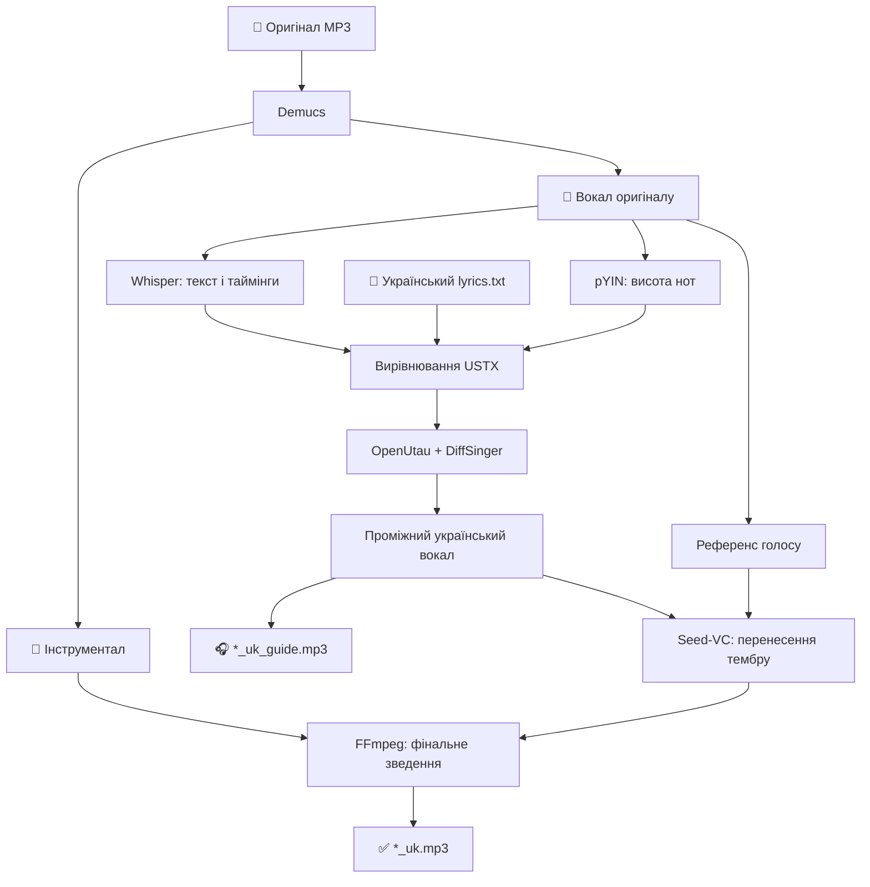

<div align="center">

# 🎙️ Vocal Translate AI

### Нова мова. Оригінальна мелодія. Максимально близький тембр вокалу.

Локальний конвеєр для створення **україномовної версії пісні** зі збереженням мелодії, ритмічної структури та інструментальної основи.


**[Швидкий старт](#швидкий-старт) · [Підготовка тексту](#підготовка-тексту) · [Режими запуску](#режими-запуску) · [Налаштування](#налаштування) · [Діагностика](#діагностика)**

</div>

> [!IMPORTANT]
> **Проєкт експериментальний.** Поточна версія виправляє низку помилок синхронізації, але **не гарантує студійної якості**. Найважливіший етап — правильний еквіритмічний переклад: український текст треба підготувати самостійно. Програма **не перекладає пісню автоматично** і не використовує Ollama або ComfyUI.

## Що вміє проєкт

| Можливість | Як реалізовано |
| :-- | :-- |
| Відокремлення вокалу від музики | **Demucs** |
| Розпізнавання оригінального тексту й таймінгів слів | **ID3 + Whisper** |
| Визначення нот і висоти оригінального співу | **librosa pYIN (F0)** |
| Розміщення українських слів за фразами, складами та нотами | **Власний алгоритм вирівнювання → USTX** |
| Синтез україномовного вокалу | **OpenUtau-Lunai + DiffSinger** |
| Наближення тембру до оригінального виконавця | **Seed-VC** |
| Зведення зі збереженим інструменталом | **FFmpeg** |
| Оброблення кількох пісень | **Послідовний пакетний режим** |

### Як це працює



Оригінальний вокал використовується як джерело **мелодії, часових опор і зразка тембру**. Нові слова співає DiffSinger; Seed-VC змінює його тембр на основі референса. Це не просте накладання перекладеного мовлення на музику.

---

## Системні вимоги

- **Windows 10/11, 64-bit**; рекомендовано Windows 11.
- **NVIDIA GPU з драйвером CUDA**. Є профілі для RTX 3080 / 3080 Ti (10–12 ГБ VRAM), сучасних NVIDIA та експериментальний полегшений профіль для GTX 970 4 ГБ.
- **PowerShell** і **winget** для автоматичного встановлення залежностей; доступ до інтернету під час першого встановлення.
- Вільне місце на SSD для моделей, робочих WAV-файлів і середовища Python.

`setup.ps1` перевіряє та за потреби встановлює Git, `uv`, FFmpeg і **.NET 10 SDK**, створює окреме Python-середовище та завантажує потрібні моделі. Після першого запуску ресурси кешуються локально; повторне завантаження зазвичай не потрібне.

> [!TIP]
> На відеокарті з 12 ГБ VRAM краще **закрити ComfyUI і вивантажити активні моделі Ollama** перед синтезом. Не запускайте одночасно кілька важких GPU-процесів.

## Швидкий старт

### 1. Завантажте код

Відкрийте **PowerShell**:

```powershell
git clone https://github.com/garik816/vocal-translate-ai.git
cd .\vocal-translate-ai

# Поки v7.6 перевіряється в окремій гілці:
git switch fix/v7-6-vocal-quality
```

Після злиття змін у `main` додаткова команда `git switch` не знадобиться.

### 2. Встановіть залежності

```powershell
.\SETUP_ONLY.bat
```

Інсталятор перевірить наявність утиліт, створить `runtime/`, завантажить Seed-VC, Whisper, Demucs, OpenUtau-Lunai та вокальний банк **Amaboshi Cipher v170**. Перший запуск потребує інтернету; якщо щось не встановилося, дивіться `logs/setup.log`.

### 3. Додайте пісню та переклад

```text
vocal-translate-ai/
└── input/
    ├── song.mp3       # оригінальна пісня
    └── lyrics.txt     # ГОТОВИЙ український еквіритмічний текст (UTF-8)
```

У `lyrics.txt` залишайте **той самий порядок куплетів і приспівів**, що й в оригіналі. Один рядок тексту бажано прирівнювати до однієї музичної фрази.

### 4. Спочатку перевірте синтетичний вокал

```powershell
.\GUIDE_ONLY.bat
```

Послухайте файл **`out/song_uk_guide.mp3`**. Це український спів DiffSinger **до перенесення тембру**.

Якщо тут неправильні слова, наголоси чи мелодія — спочатку виправте текст або нотне вирівнювання. Запуск Seed-VC цього не полагодить.

### 5. Згенеруйте фінальну версію

```powershell
.\RUN.bat
```

Після оброблення перевірте **`out/song_uk.mp3`**. Він містить новий вокал із перенесеним тембром та інструментальну основу, відновлену Demucs.

> **Важливо:** `RUN.bat` знову виконує необхідні етапи підготовки й синтезу; `GUIDE_ONLY.bat` — це окремий режим перевірки, а не команда «продовжити з останнього місця».

---

## Підготовка тексту

Якість еквіритмічного тексту визначає, наскільки природно звучатиме результат. Намагайтеся зберегти:

1. **Кількість складів** у кожній музичній фразі.
2. **Наголоси** — на відповідних сильних долях.
3. **Початок і закінчення рядків**, паузи та довгі голосні.
4. **Послідовність секцій**: куплет, приспів, брідж.
5. **Природну українську вимову**, а не дослівність перекладу будь-якою ціною.

Приклад структури файлу (умовний текст):

```text
[Verse 1]
Тихий вечір огортає місто,
Світло тане у моїх руках.

[Chorus]
Ми зустрінемо новий світанок,
І нехай лунає наша пісня.

[Verse 2]
Наступна строфа...

[Chorus]
Повтор приспіву...
```

`[Verse]`, `[Verse 1]`, `[Chorus]`, `[Bridge]` — маркери секцій, а не слова для співу. Збережіть TXT в **UTF-8**. Програма не змінює ваш авторський текст, хоча може нормалізувати невидимі символи під час синтезу.

### Як додати додатковий фінальний приспів

**Звичайний заключний `[Chorus]` залишається на своєму місці в оригінальній пісні.** Якщо хочете **додати новий приспів після завершення оригіналу**, запишіть останню секцію так:

```text
[Chorus repeat]
Текст додаткового приспіву...
```

За умови `"append_final_repeated_section": true` програма візьме структуру попереднього приспіву, додасть інструментальний фрагмент і розмістить там новий вокал. **Не позначайте існуючий фінальний приспів як `repeat`.**

---

### Завершальна вокальна кода (Outro)

Якщо **в оригіналі після довгої інструментальної паузи знову звучить спів**, а український текст закінчується раніше, додайте в самому кінці TXT окремий розділ:

```text
[Outro]
Український еквіритмічний текст завершальної фрази
```

У такому випадку програма **залишить фінальні слова оригіналу в даних Whisper** і спробує вирівняти по них заключну українську фразу. Якщо `[Outro]` немає, короткий фінальний вокальний «хвіст» після довгої паузи може бути виключений із вирівнювання. Важливо: точність нот у тихому завершенні потребує окремої перевірки `guide.ustx` та `*_uk_guide.mp3`.

## Пакетна обробка та голосові референси

### Кілька пісень

```text
input/
├── song1.mp3
├── song2.mp3
└── lyrics/
    ├── song1.txt
    └── song2.txt
```

Назви файлів перекладу мають збігатися з назвами MP3 без розширення. Також можна покласти `song1.txt` поруч із `song1.mp3`. За замовчуванням пісні обробляються **послідовно**, а один `lyrics.txt` не використовується автоматично для всіх треків.

### Зразок тембру виконавця

Можна передати чистий зразок співу у WAV:

```text
input/
├── song1.mp3
├── song2.mp3
├── reference.wav           # один зразок для всіх пісень (необов'язково)
└── reference/
    ├── song1.wav           # окремий зразок для song1
    └── song2.wav
```

Пріоритет: `input/reference/song1.wav` → `input/song1.wav` → `input/reference.wav` → **автоматично виділений вокал оригіналу**. За замовчуванням для Seed-VC береться приблизно **8 секунд**. Чистий вокал без музики й реверберації зазвичай є кращим референсом.

## Режими запуску

| Команда з папки проєкту | Дія |
| :-- | :-- |
| `.\SETUP_ONLY.bat` | Встановити й перевірити залежності |
| `.\EXTRACT_LYRICS.bat` | Витягти оригінальний текст і часові позначки без синтезу |
| `.\GUIDE_ONLY.bat` | Згенерувати український guide-вокал без Seed-VC |
| `.\RUN.bat` | Повний конвеєр до фінального MP3 |
| `.\DIAGNOSE.bat` | Перевірити стан середовища, створити діагностичний лог |
| `.\FORCE_REPAIR.bat` | Примусово перевстановити/перевірити компоненти середовища |

### Витягнення тексту оригіналу

```powershell
.\EXTRACT_LYRICS.bat
```

Програма шукає текст у ID3-тегах MP3 та використовує Whisper для розпізнавання вокалу й часових міток. Результат:

```text
out/
├── song_source_lyrics.txt
├── song_source_lyrics.srt
└── song_source_lyrics.json
```

**Ці файли — оригінальний текст**, а не готовий український переклад. Розпізнавання співу може помилятися; за потреби перевіряйте текст і таймінги вручну.

---

## Налаштування

Основні параметри знаходяться в **`config.json`**. Редагуйте файл у будь-якому текстовому редакторі, зберігаючи правильний JSON.

| Параметр | Типове значення | Призначення |
| :-- | :-- | :-- |
| `asr_language` | `"auto"` | Мова оригіналу; для англійського вокалу можна вказати `"en"` |
| `asr_model` | `"turbo"` | Модель Whisper |
| `demucs_model` | `"htdemucs"` | Розділення джерел |
| `melody_fmin` / `melody_fmax` | `55` / `880` | Межі пошуку основної частоти, Гц |
| `diffsinger_singer` | `"Amaboshi Cipher"` | Проміжний україномовний голос |
| `diffsinger_steps` | `30` | Кроки синтезу DiffSinger |
| `seed_vc_enabled` | `true` | Перенесення тембру; `false` залишає guide-голос |
| `seed_vc_diffusion_steps` | `50` | Кроки Seed-VC; для RTX 3080 профіль обмежує до 45 |
| `reference_seconds` | `8` | Тривалість голосового референса |
| `append_final_repeated_section` | `true` | Дозволити лише **явно позначений** фінальний повтор |
| `mix_vocal_gain_db` | `0` | Рівень вокалу в фінальному міксі, dB |
| `mix_instrumental_gain_db` | `0` | Рівень інструменталу, dB |
| `output_bitrate` | `"320k"` | Бітрейт вихідного MP3 |

Для тестування **не підвищуйте одразу всі параметри якості**: на GPU з 10–12 ГБ VRAM це може призвести до нестачі пам'яті без помітного покращення результату.

## Результати та діагностичні файли

```text
out/
├── song_uk_guide.mp3        # перевірка українського співу до Seed-VC
├── song_uk.mp3              # фінальний мікс
├── song_source_lyrics.txt   # текст оригіналу
├── song_source_lyrics.srt   # субтитри з таймінгами
└── song_source_lyrics.json  # слова / часові дані

work/song/
├── source_lyrics/
├── melody/
│   └── melody.json         # витягнуті ноти
├── diffsinger/
│   ├── guide.ustx          # проєкт нот і складів для OpenUtau
│   ├── alignment.json      # розподіл фраз/рядків
│   └── guide_uk.wav        # чистий guide-вокал
└── seed_vc/                # результати перенесення тембру

logs/
├── setup.log
├── run.log
├── demucs.log
├── asr.log
├── melody.log
├── diffsinger.log
├── seed_vc.log
├── ffmpeg.log
└── diagnose.log
```

Файли в `work/` створюються під час оброблення; не всі каталоги існуватимуть після часткового запуску.

## Як перевірити якість

**Послідовність перевірки важливіша за налаштування Seed-VC.**

| Симптом | Де перевірити | Що робити |
| :-- | :-- | :-- |
| Слова пропущені або рядок починається не там | `out/*_uk_guide.mp3`, `alignment.json` | Перевірити структуру секцій, таймінги Whisper, еквіритмічність тексту |
| Голос співає не ті ноти | `melody.json`, `guide.ustx` | Перевірити F0 та ноти, за потреби вручну відкоригувати USTX |
| Українська вимова уривчаста або неправильна | `guide_uk.wav`, `logs/diffsinger.log` | Перевірити фонемізацію, розподіл складів, вокальний банк |
| Guide гарний, але фінал хрипить або спотворений | `logs/seed_vc.log` | Перевірити референс, кроки Seed-VC, доступну VRAM |
| У фіналі чутно залишки іншомовного вокалу | Інструментальний WAV після Demucs | Спробувати якіснішу сепарацію або студійний інструментал |
| Вокал і музика розходяться після додаткового приспіву | `[Chorus repeat]`, `repeat_section_gap_s` | Перевірити, що додано саме **нову** секцію, а не повторено наявну |

### Якщо щось не запускається

1. Запустіть `.\DIAGNOSE.bat` і перегляньте `logs/diagnose.log`.
2. За помилки встановлення перевірте `logs/setup.log`; за помилки синтезу — відповідний `logs/*.log`.
3. Якщо середовище пошкоджене, запустіть `.\FORCE_REPAIR.bat`.
4. Для проблем з одним рядком починайте з `GUIDE_ONLY.bat`: **поганий guide Seed-VC не виправить**.

> [!WARNING]
> **Обмеження алгоритму:** часові позначки Whisper даються для слів, а межі складів усередині слів оцінюються евристично. У складних піснях можливі помилки наголосів, нот, мелізмів і пауз. Вокальний референс не гарантує ідентичності голосу. Відокремлений Demucs інструментал не тотожний оригінальній студійній мінусовці.

---

## Для розробників

- Основна логіка — `app.py` та `vta/`.
- Оброблення тональності — `scripts/extract_melody.py`.
- Генерація нот і USTX — `vta/ustx.py`.
- Консольний OpenUtau — `tools/OpenUtauHeadless/`.
- Регресійні тести — `tests/test_alignment.py`; також запускаються через GitHub Actions.
- Деталі змін між версіями — **[CHANGELOG.md](CHANGELOG.md)**.

Після встановлення залежностей перевірка без генерації аудіо:

```powershell
.\runtime\seed-vc\.venv\Scripts\python.exe -m unittest discover -s tests -v
```

## Використані проєкти

[Demucs](https://github.com/facebookresearch/demucs) · [Whisper](https://github.com/openai/whisper) · [OpenUtau-Lunai](https://github.com/keirokeer/OpenUtau-lunai) · [Seed-VC](https://github.com/Plachtaa/seed-vc) · [FFmpeg](https://ffmpeg.org/)

Проєкт зберігає аудіо, переклади, моделі, логи та результати локально; робочі каталоги й персональні аудіофайли виключено з Git через `.gitignore`.

### Авторські права та право на голос

Для публікації або комерційного використання перевірте права на **композицію, текст і його переклад, оригінальну фонограму та використання впізнаваного голосу виконавця**. Не видавайте AI-версію за справжній запис артиста без його дозволу.

---

<div align="center">

**[Повернутися до початку ↑](#-vocal-translate-ai)** · [Коротка інструкція](QUICKSTART.md) · [Історія змін](CHANGELOG.md)

</div>
